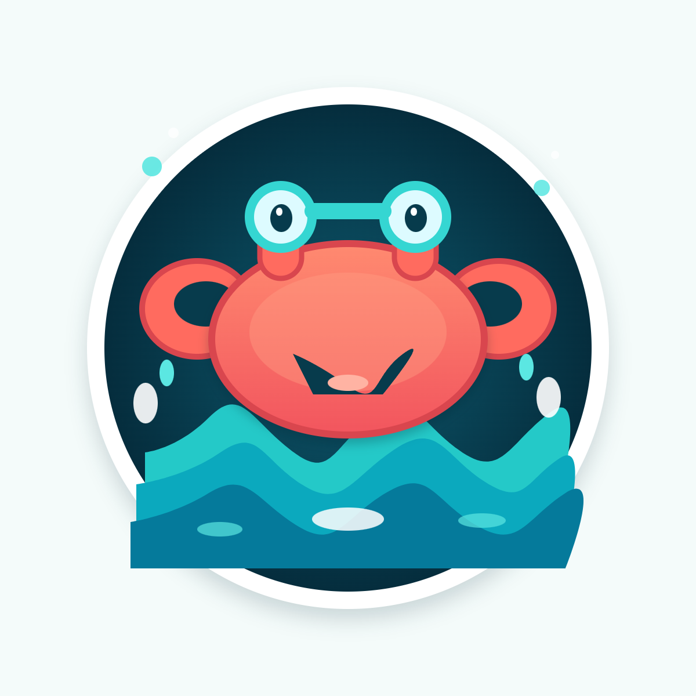
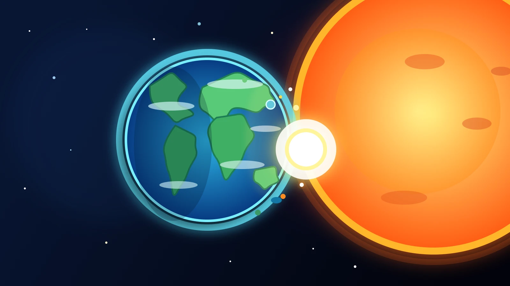
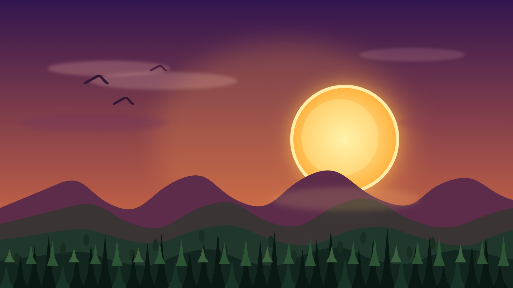
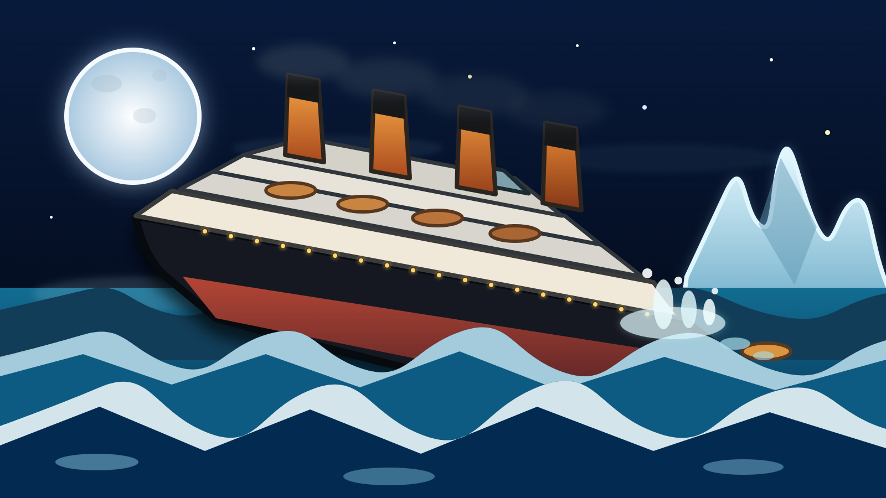

<div align="center">


# lunaticDesign

**A free, open-source vector, pixel and layout editor.**

Vector shapes, photo editing, multi-page layouts, typography and slices in one dense, dark workspace.
Runs as a Windows app and in the browser. Nothing is uploaded: your work stays on your computer.

[](https://github.com/plawanpawin-byte/VectorEdit/releases/latest)
&nbsp;
[](LICENSE)


</div>

## A look around

<table>
  <tr>
    <td width="50%"><br/><b>Vector</b> &mdash; shapes, layers, colour and an Affinity-style toolbox</td>
    <td width="50%"><br/><b>Pixel</b> &mdash; a photo imported as a layer, with brushes and filters</td>
  </tr>
  <tr>
    <td><br/><b>Typography</b> &mdash; headline, paragraph and pull quote, with the Character panel</td>
    <td><br/><b>Layout</b> &mdash; pages and page thumbnails for multi-page documents</td>
  </tr>
  <tr>
    <td><br/><b>Slice</b> &mdash; export parts of a design at chosen sizes</td>
    <td><br/><b>Start page</b> &mdash; new document, open, recent files</td>
  </tr>
</table>

## Made in lunaticDesign

<table>
  <tr>
    <td width="50%" align="center"><br/><b>Crab</b> &mdash; a friendly crab in a round badge, above layered waves</td>
    <td width="50%" align="center"><br/><b>Earth and sun</b> &mdash; a glowing planet beside a bright sun</td>
  </tr>
  <tr>
    <td align="center"><br/><b>Sunset</b> &mdash; a sun behind layered mountains and pine trees</td>
    <td align="center"><br/><b>Fishing boat</b> &mdash; a boat on calm waves with a buoy line</td>
  </tr>
  <tr>
    <td align="center" colspan="2"><br/><b>Iceberg</b> &mdash; a steamship at night beside an iceberg under a full moon</td>
  </tr>
</table>

## EditCurser

EditCurser is the first of a growing family of free, open-source creative tools, each able to stand on its own.

| | App | What it&rsquo;s for | Code |
| --- | --- | --- | --- |
|  | **lunaticDesign** | Vector illustration, photo editing and page layout &middot; **you are here** | [GitHub](https://github.com/plawanpawin-byte/VectorEdit) |

## Get it

| How | Steps |
| --- | --- |
| **Windows app** | Open the repository's **Releases** page and download `lunaticDesign-Setup-<version>.exe` (installer) or `lunaticDesign-Portable-<version>.exe` (no install, just run it). The app is not code-signed, so Windows SmartScreen warns the first time: *More info → Run anyway*. |
| **In the browser** | When the maintainer has published the web version, open the repository's GitHub Pages address. Nothing to install; your work stays in that browser. |

## Your files and privacy

lunaticDesign has **no accounts, no server and no sync**. Nothing you create is uploaded anywhere, and nobody else can see it.

- Documents are `.vedit` files that you save where you choose; export to PNG, SVG, PDF or slices.
- An automatic recovery copy of the page you are working on is kept **only on your own computer** (inside the browser profile or the desktop app's data folder). Every person who installs the app starts with an empty page and never sees anyone else's work.
- The start page lists the files you recently opened or saved (desktop app, stored on your computer). Use **Discard unsaved work** on the start page to delete the recovery copy.

## Works offline

Nothing is fetched from the internet. The app, its fonts and tools all come with the installer, so it works with no network at all. Documents, recent files and exports are kept on your computer. The first time the app starts it creates a folder named **Lunatic Design** in your Documents folder, and Open, Save and Export use it by default.

## Working with AI agents (MCP)

Lunatic Design can be driven by AI agents through the [Model Context Protocol](https://modelcontextprotocol.io). After one setup command, **Claude Code**, **Codex** and **Antigravity** can read the open document, add and change shapes and text, undo, look at the result as a picture, and save or open documents in the Lunatic Design folder.

**Setup, once, in a terminal** (step by step with screenshots: [docs/mcp-tutorial.md](docs/mcp-tutorial.md)):

```powershell
$exe = (Get-ChildItem "$env:LOCALAPPDATA\Programs" -Filter "Lunatic Design.exe" -Recurse -EA 0 | Select-Object -First 1).FullName; & $exe --install-mcp
```

It adds the server to each agent's configuration, merging with what is already there (other servers stay), and keeps a `.bak` copy of any file it changes. The result is written to `install-mcp.log` in the app's data folder. Then restart the agents. The app's **Window → Connect AI agents…** window shows the same command with a copy button.

Keep Lunatic Design open while an agent works. The agent starts the app's MCP server (`Lunatic Design.exe --mcp`), which talks to the running window over a private connection on this computer. The connection needs a secret token, accepts only requests from this computer, and is removed when the app closes. Agents can only write inside the Lunatic Design folder, and they ask before replacing unsaved work.

| Tool | What it does |
| --- | --- |
| `get_status`, `get_document` | Read the pages, the shapes and their ids |
| `new_document`, `add_shape`, `add_shapes`, `update_shape`, `delete_shapes`, `select_shapes` | Build and change the design |
| `undo`, `redo` | Step back or forward |
| `render_page`, `screenshot` | See the page or the whole window as a picture |
| `list_documents`, `save_document`, `open_document` | Work with files in the Lunatic Design folder |

## Themes

Window → Theme switches between **Dark** (the default) and **Light**. The choice is remembered on this computer.

## Starting, opening and importing

The app opens on a **start page** with **New document…** (Ctrl+N), **Open…** (Ctrl+O) and your recent files. New document offers A0–A6, Letter, Legal and Tabloid paper, screen, social and photo sizes, or a custom
width and height in px, mm, cm, pt or in, in portrait or landscape. **File → Import images or SVG** (Ctrl+Shift+I in the desktop app),
dragging files onto the window, and **Ctrl+V** all bring in PNG, JPG, GIF, WebP, BMP, AVIF, ICO and SVG. SVG files become editable
shapes; pictures become image layers. Pasting a screenshot or SVG code works too.

## What works

Nine workspaces (Vector, Pixel, Retouching, Colour Grading, Compositing, Layout, Typography, Slice, Scripting), each with its own toolbox and panels:

| Workspace | Highlights |
| --- | --- |
| **Vector** | Pen, Pencil, Vector Brush, Node/Corner tools, Knife, Scissors, 26 parametric shapes (star, double star, square star, cat, elliptical callout, cog, spiral, heart, QR code with URL/email/phone/SMS/Wi-Fi payloads…), an Object menu (Divide, reverse, join, smooth, separate, step and repeat, image trace to vector, show/hide/lock all), Transparency, Contour, Perspective and Envelope Warp (3×3 to 6×6 mesh) tools, 9 pattern fills, boolean ops, Expand Stroke, nested groups in a Layers tree, clipping masks, adjustment layers that can be limited to an outline, non-destructive adjustment layers, gradients and patterns, stroke alignment and arrowheads, 8 stackable effects, blend modes, multiple artboards, guides, snapshots |
| **Pixel** | Macro recorder (record filters, replay in one undo step, import/export JSON), raster layers, 14 brush presets, selection tools (marquee, lasso, magic wand, colour range), clone/heal/dodge/burn/blur/smudge, fill and gradient, 51 live-preview adjustments and filters (median, bilateral, lens blur, diffuse glow, selective colour, polar conversions, normal map…), merge down |
| **Retouching / Colour Grading / Compositing** | Focused toolboxes built from the pixel tools: healing, clone, dodge/burn, adjustment and filter brushes, colour replacement, perspective and mesh warp |
| **Layout** | Master pages (content repeats behind every page that uses it), Pages panel, image and picture frames, tables, text frames, grid |
| **Typography** | Artistic and frame text, Character / Paragraph / Text Styles panels, wrapping, alignment and justify |
| **Slice** | Slice tool, Slices panel, per-slice format (PNG/JPEG/SVG) and scale, export all |
| **Scripting** | JavaScript `app` API (add, update, remove, group, select, pages, undo), saved macros; a whole script is one undo step |

Also: PDF export (vector for plain shapes, image fallback), SVG import, colour scopes, data merge (CSV → pages), layer masks, pen-pressure brushes, autosave (IndexedDB) with crash recovery, `.vedit` documents, SVG/PNG export, per-workspace shortcuts.

## Limitations

lunaticDesign is a young project and does **not** have everything Affinity has. See [docs/COVERAGE.md](docs/COVERAGE.md) for a feature-by-feature checklist. Missing today: AI features, filter layers and live masks for pixel layers, custom brush response curves, vector PDF for text and gradients, CMYK, free-form mesh-point gradients (a colour-grid mesh fill exists), and Affinity file-format import. Master pages repeat content but have no page numbering or spreads yet. Text styles are stored per browser. Scripts are not sandboxed, so only run code you trust.

## Layout

```
src/
  store.ts, types.ts, document.ts   state, history, file format
  geometry.ts, pathops.ts, boolean.ts, offset.ts   vector maths
  tools/                            one file per tool family (plugin registry)
  raster/                           pixel layers, brushes, filters
  components/                       Canvas, panels, top bar
  scripting.ts, slices.tsx          automation and slice export
tests/                              Vitest suites
```

## Contributing

See [CONTRIBUTING.md](CONTRIBUTING.md). MIT licensed (see [LICENSE](LICENSE)).

## Disclaimer

lunaticDesign is an independent open-source project. It is not affiliated with, endorsed by or derived from Affinity, Canva or Serif. All code, icons and assets are original.
