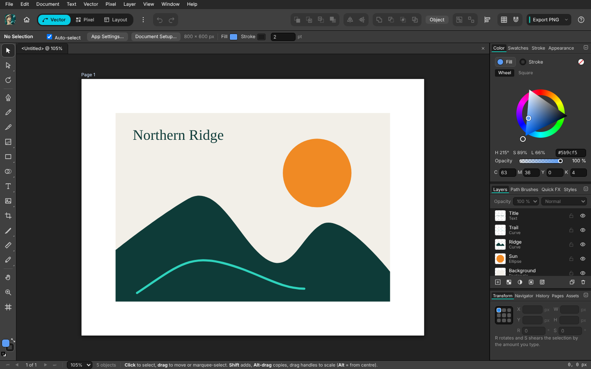
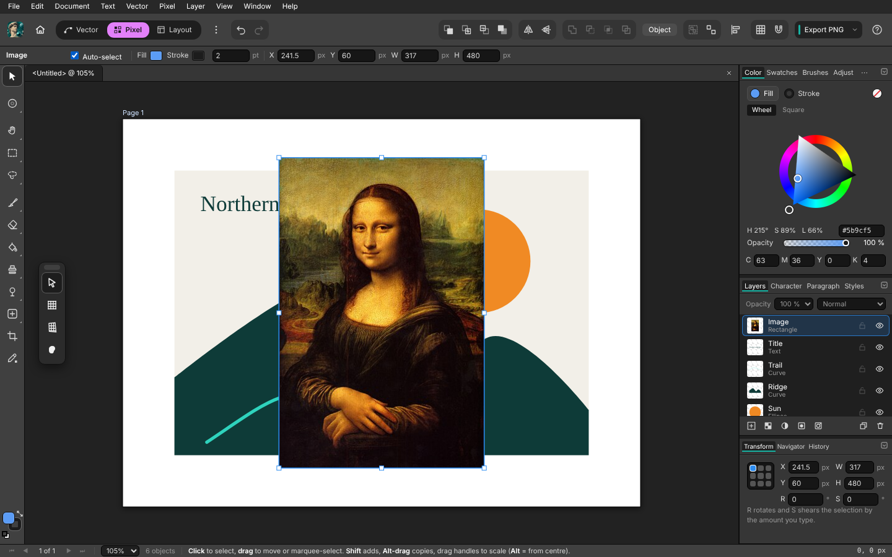
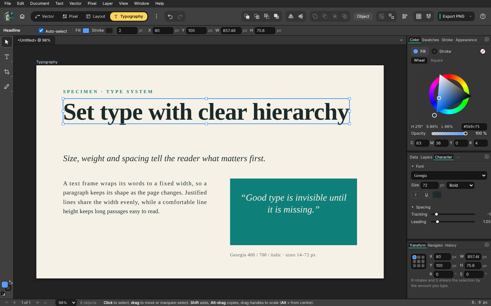
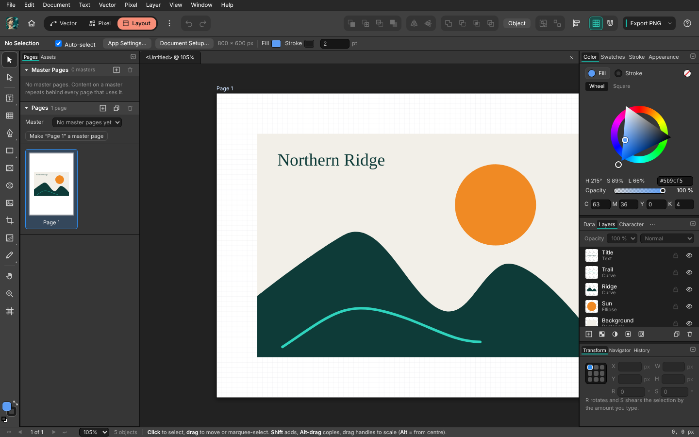
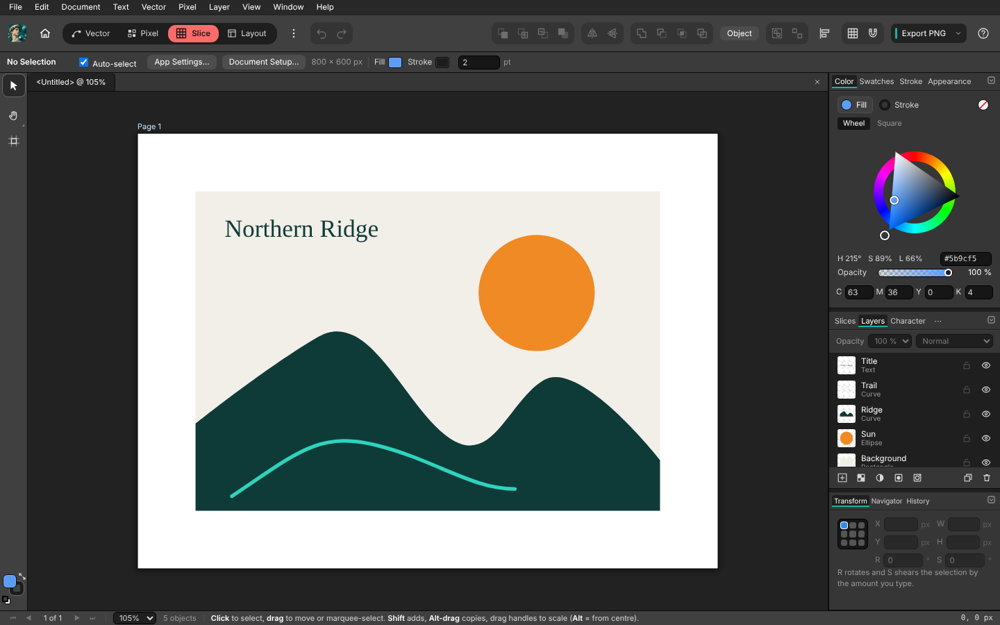
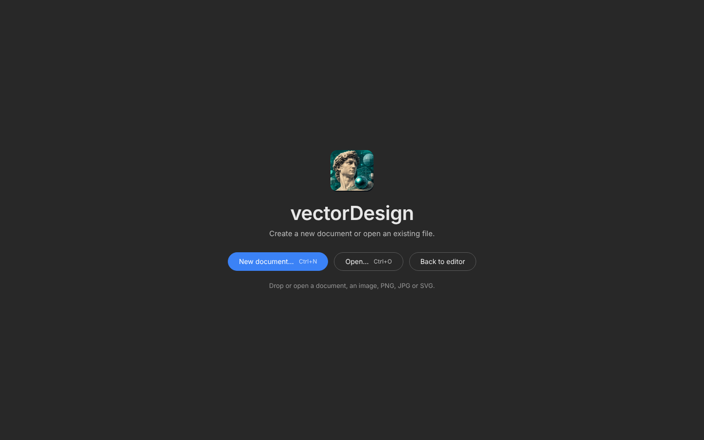
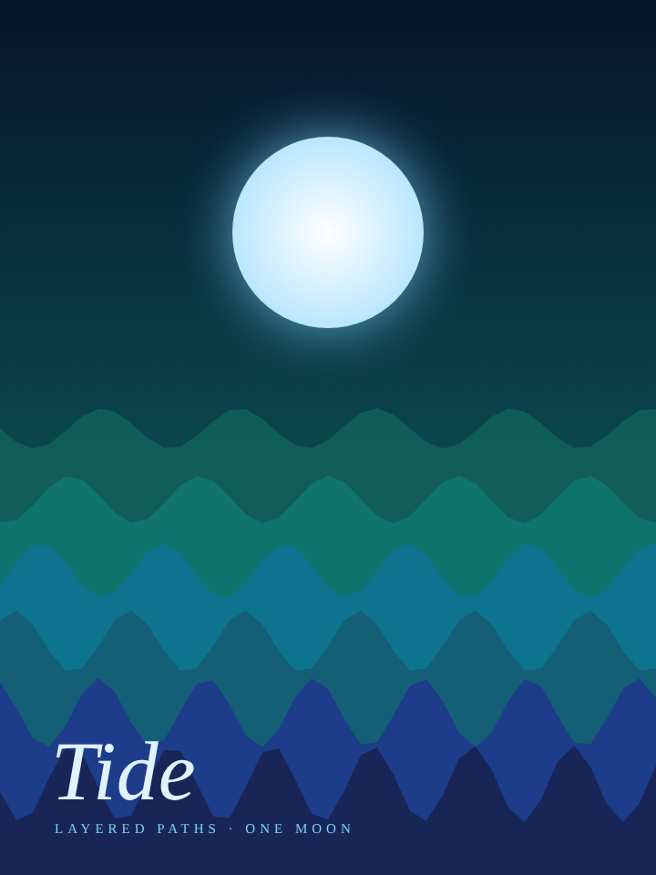
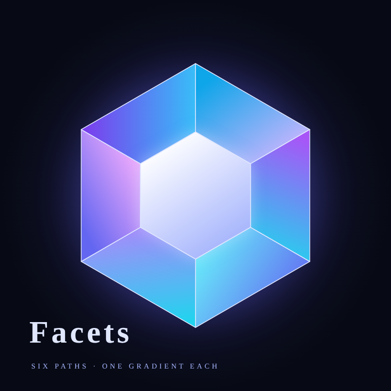
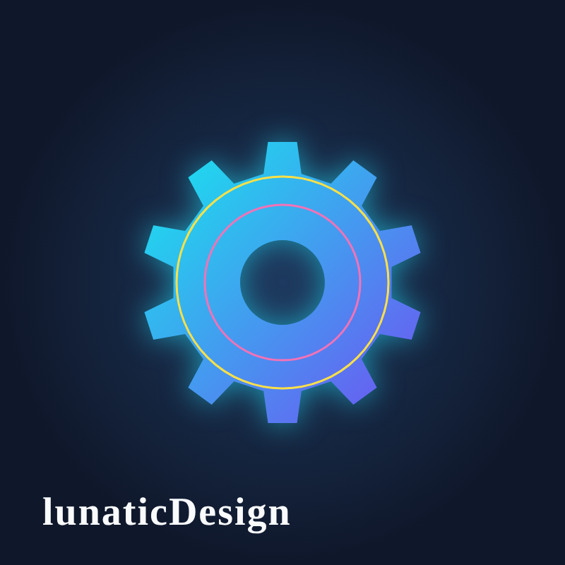
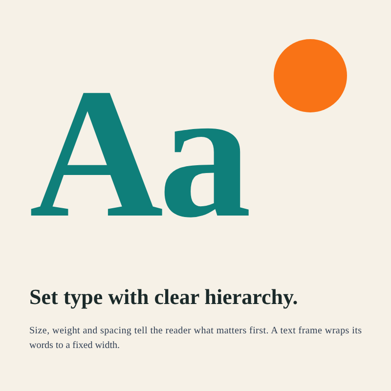

<div align="center">


# lunaticDesign

**A free, open-source vector, pixel and layout editor.**

Vector shapes, photo editing, multi-page layouts, typography and slices in one dense, dark workspace.
Runs as a Windows app and in the browser. Nothing is uploaded: your work stays on your computer.

[](https://github.com/plawanpawin-byte/VectorEdit/releases/latest)
&nbsp;
[](LICENSE)


</div>

## A look around

<table>
  <tr>
    <td width="50%"><br/><b>Vector</b> &mdash; shapes, layers, colour and an Affinity-style toolbox</td>
    <td width="50%"><br/><b>Pixel</b> &mdash; a photo imported as a layer, with brushes and filters</td>
  </tr>
  <tr>
    <td><br/><b>Typography</b> &mdash; headline, paragraph and pull quote, with the Character panel</td>
    <td><br/><b>Layout</b> &mdash; pages and page thumbnails for multi-page documents</td>
  </tr>
  <tr>
    <td><br/><b>Slice</b> &mdash; export parts of a design at chosen sizes</td>
    <td><br/><b>Start page</b> &mdash; new document, open, recent files</td>
  </tr>
</table>

## Made in lunaticDesign

<table>
  <tr>
    <td width="50%" align="center"><br/><b>Tide</b> &mdash; six wave paths and a glowing moon</td>
    <td width="50%" align="center"><br/><b>Facets</b> &mdash; a gem built from six gradient paths</td>
  </tr>
  <tr>
    <td align="center"><br/><b>Geometry</b> &mdash; a parametric cog with glow and rings</td>
    <td align="center"><br/><b>Type</b> &mdash; a specimen with a justified text frame</td>
  </tr>
</table>

## Apps in this family

| App | What it is for | Status |
| --- | --- | --- |
| **lunaticDesign** | Vector illustration, photo editing and page layout | Version 0.3, in active development |

## Get it

| How | Steps |
| --- | --- |
| **Windows app** | Open the repository's **Releases** page and download `lunaticDesign-Setup-<version>.exe` (installer) or `lunaticDesign-Portable-<version>.exe` (no install, just run it). The app is not code-signed, so Windows SmartScreen warns the first time: *More info → Run anyway*. |
| **In the browser** | When the maintainer has published the web version, open the repository's GitHub Pages address. Nothing to install; your work stays in that browser. |
| **From source** | `npm install`, then `npm run dev` (browser) or `npm run electron:start` (desktop). See below. |

## Your files and privacy

lunaticDesign has **no accounts, no server and no sync**. Nothing you create is uploaded anywhere, and nobody else can see it.

- Documents are `.vedit` files that you save where you choose; export to PNG, SVG, PDF or slices.
- An automatic recovery copy of the page you are working on is kept **only on your own computer** (inside the browser profile or the desktop app's data folder). Every person who installs the app starts with an empty page and never sees anyone else's work.
- The start page lists the files you recently opened or saved (desktop app, stored on your computer). Use **Discard unsaved work** on the start page to delete the recovery copy.

## Run

```bash
npm install
npm run dev      # http://localhost:5173
npm run build    # typecheck + production bundle in dist/
npm test         # unit tests (geometry, boolean ops, history, groups)
```

## Desktop app (Electron)

```bash
npm run electron:dev    # Vite dev server + Electron window with hot reload
npm run electron:start  # build, then open the production bundle in Electron
npm run electron:pack   # unpacked app in release/ (no installer)
npm run electron:dist   # installer for the current OS (NSIS/portable, dmg, AppImage)
```

The desktop build adds a native menu, Open/Save/Save As for `.vedit` documents, native export dialogs and
the file name in the window title. In the browser, Save downloads a `.vedit` file and Open uses a file picker.
Installers for Windows are best built on Windows, macOS ones on macOS.

### Windows installer without building it yourself

The **Build Windows app** workflow builds the installer (`lunaticDesign-Setup-<version>.exe`) and a portable
`lunaticDesign-Portable-<version>.exe` on GitHub's Windows runners. Run it from the repository's *Actions* tab
(*Build Windows app* → *Run workflow*) and download the files from the run's *Artifacts*. Pushing a tag
such as `v0.1.0`, or running the workflow with a *tag* value, also publishes both files on the repository's Releases page. The installer is not code-signed, so Windows
SmartScreen shows a warning the first time (*More info → Run anyway*).

Double-clicking a `.vedit` file opens it in the running app; closing the window with unsaved changes asks first.

## Starting, opening and importing

The app opens on a **start page** with **New document…** (Ctrl+N), **Open…** (Ctrl+O) and your recent files. New document offers A0–A6, Letter, Legal and Tabloid paper, screen, social and photo sizes, or a custom
width and height in px, mm, cm, pt or in, in portrait or landscape. **File → Import images or SVG** (Ctrl+Shift+I in the desktop app),
dragging files onto the window, and **Ctrl+V** all bring in PNG, JPG, GIF, WebP, BMP, AVIF, ICO and SVG. SVG files become editable
shapes; pictures become image layers. Pasting a screenshot or SVG code works too.

## What works

Nine workspaces (Vector, Pixel, Retouching, Colour Grading, Compositing, Layout, Typography, Slice, Scripting), each with its own toolbox and panels:

| Workspace | Highlights |
| --- | --- |
| **Vector** | Pen, Pencil, Vector Brush, Node/Corner tools, Knife, Scissors, 26 parametric shapes (star, double star, square star, cat, elliptical callout, cog, spiral, heart, QR code with URL/email/phone/SMS/Wi-Fi payloads…), an Object menu (Divide, reverse, join, smooth, separate, step and repeat, image trace to vector, show/hide/lock all), Transparency, Contour, Perspective and Envelope Warp (3×3 to 6×6 mesh) tools, 9 pattern fills, boolean ops, Expand Stroke, nested groups in a Layers tree, clipping masks, adjustment layers that can be limited to an outline, non-destructive adjustment layers, gradients and patterns, stroke alignment and arrowheads, 8 stackable effects, blend modes, multiple artboards, guides, snapshots |
| **Pixel** | Macro recorder (record filters, replay in one undo step, import/export JSON), raster layers, 14 brush presets, selection tools (marquee, lasso, magic wand, colour range), clone/heal/dodge/burn/blur/smudge, fill and gradient, 51 live-preview adjustments and filters (median, bilateral, lens blur, diffuse glow, selective colour, polar conversions, normal map…), merge down |
| **Retouching / Colour Grading / Compositing** | Focused toolboxes built from the pixel tools: healing, clone, dodge/burn, adjustment and filter brushes, colour replacement, perspective and mesh warp |
| **Layout** | Master pages (content repeats behind every page that uses it), Pages panel, image and picture frames, tables, text frames, grid |
| **Typography** | Artistic and frame text, Character / Paragraph / Text Styles panels, wrapping, alignment and justify |
| **Slice** | Slice tool, Slices panel, per-slice format (PNG/JPEG/SVG) and scale, export all |
| **Scripting** | JavaScript `app` API (add, update, remove, group, select, pages, undo), saved macros; a whole script is one undo step |

Also: PDF export (vector for plain shapes, image fallback), SVG import, colour scopes, data merge (CSV → pages), layer masks, pen-pressure brushes, autosave (IndexedDB) with crash recovery, `.vedit` documents, SVG/PNG export, Electron desktop build, per-workspace shortcuts.

## Limitations

lunaticDesign is a young project and does **not** have everything Affinity has. See [docs/COVERAGE.md](docs/COVERAGE.md) for a feature-by-feature checklist. Missing today: AI features, filter layers and live masks for pixel layers, custom brush response curves, vector PDF for text and gradients, CMYK, free-form mesh-point gradients (a colour-grid mesh fill exists), and Affinity file-format import. Master pages repeat content but have no page numbering or spreads yet. Text styles are stored per browser. Scripts are not sandboxed, so only run code you trust.

## Layout

```
src/
  store.ts, types.ts, document.ts   state, history, file format
  geometry.ts, pathops.ts, boolean.ts, offset.ts   vector maths
  tools/                            one file per tool family (plugin registry)
  raster/                           pixel layers, brushes, filters
  components/                       Canvas, panels, top bar
  scripting.ts, slices.tsx          automation and slice export
tests/                              Vitest suites
```

## Contributing

See [CONTRIBUTING.md](CONTRIBUTING.md). MIT licensed (see [LICENSE](LICENSE)).

## Disclaimer

lunaticDesign is an independent open-source project. It is not affiliated with, endorsed by or derived from Affinity, Canva or Serif. All code, icons and assets are original.
